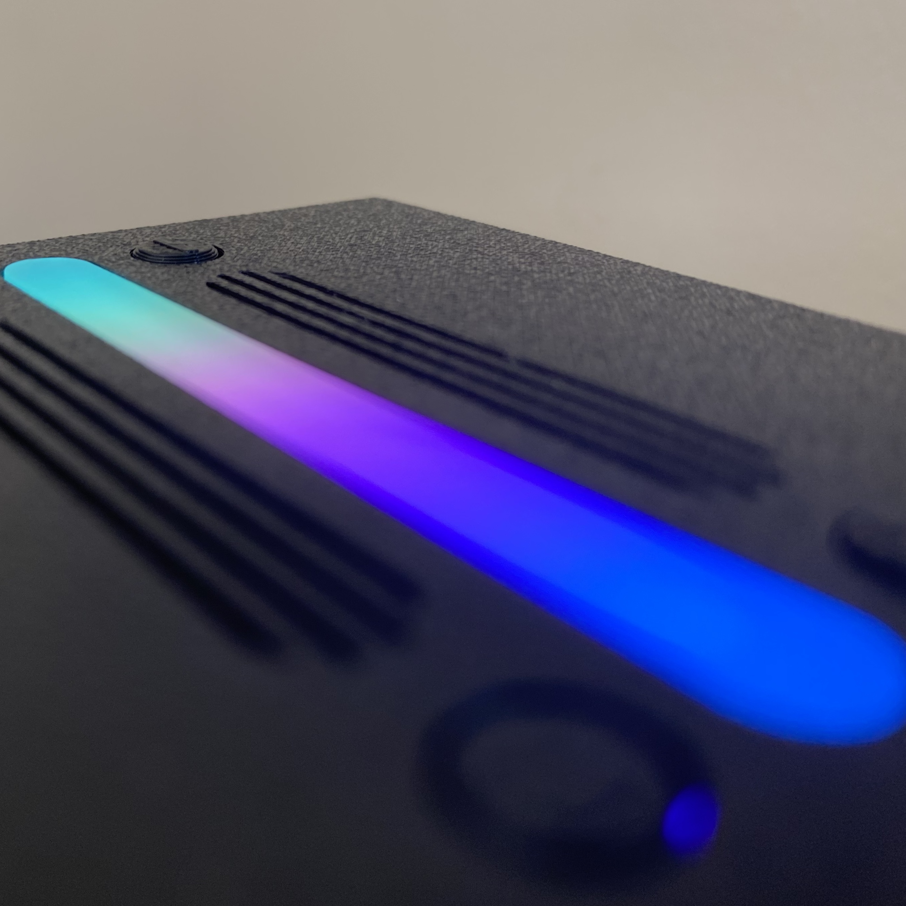
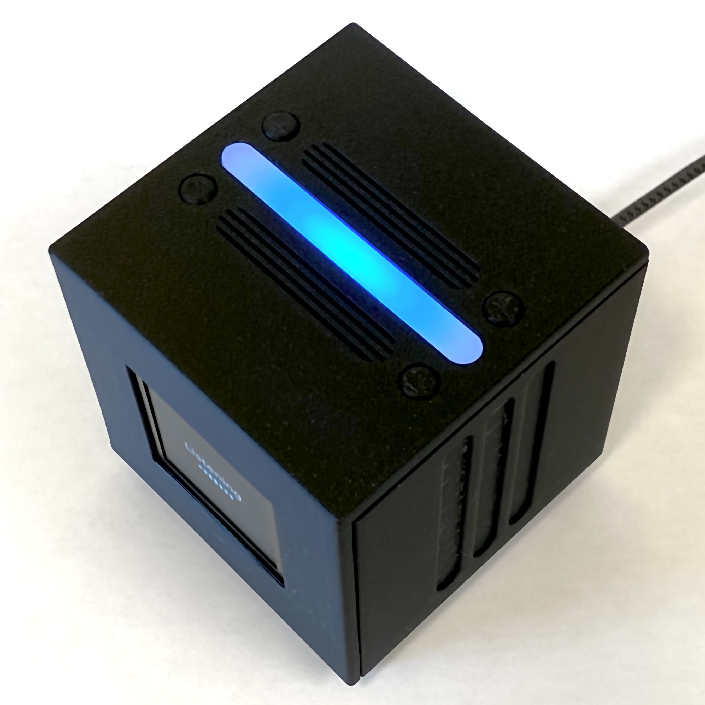
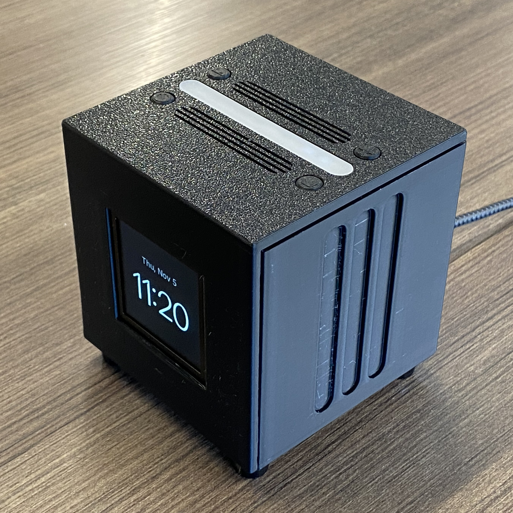
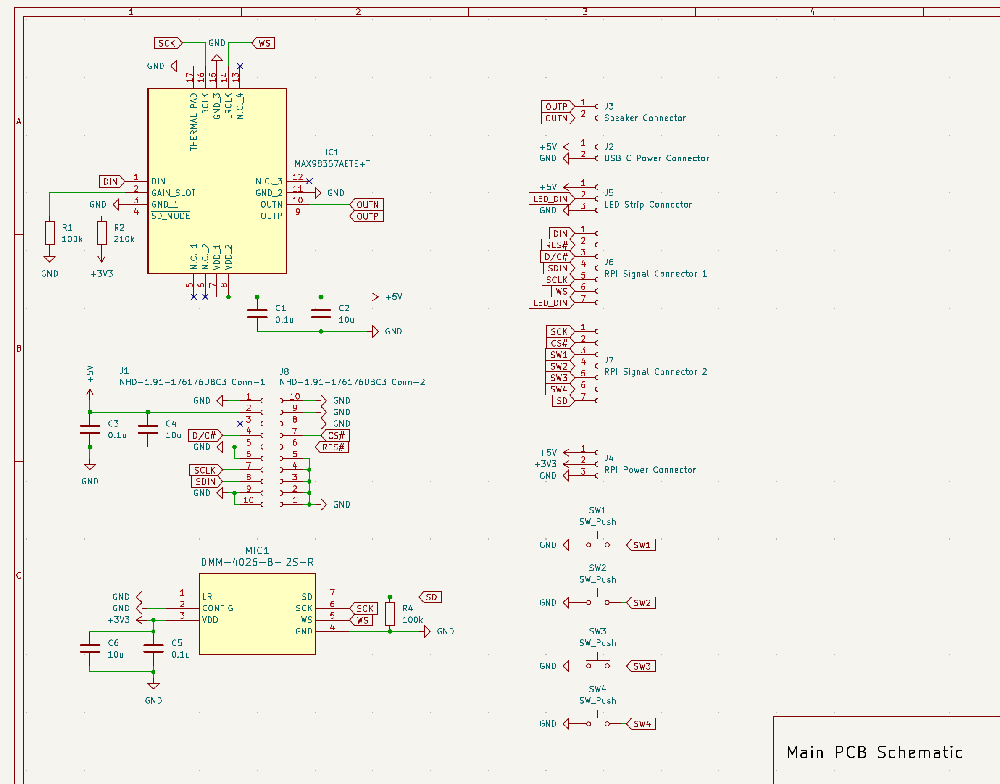
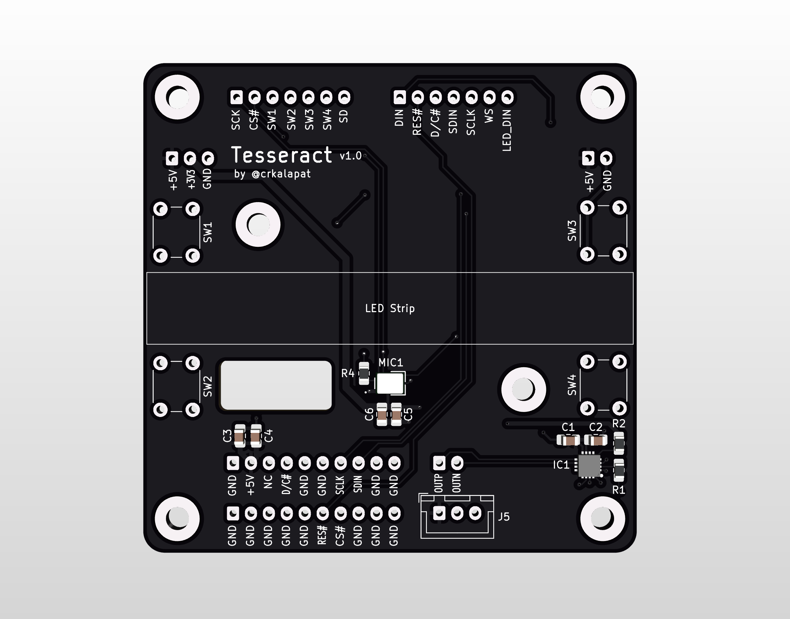
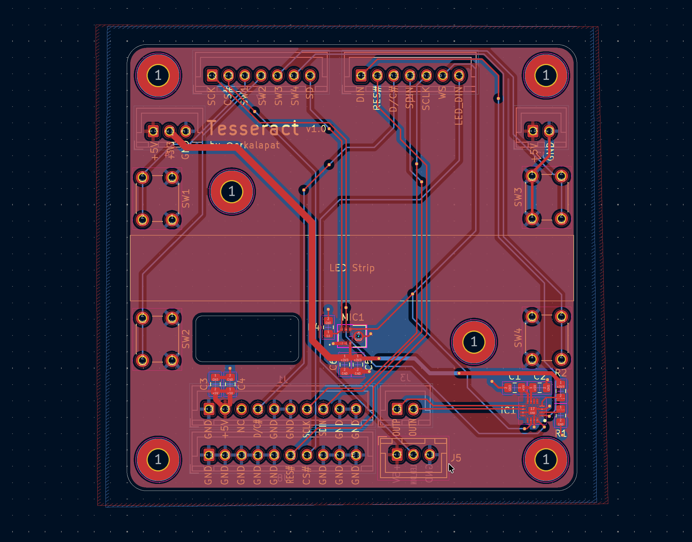
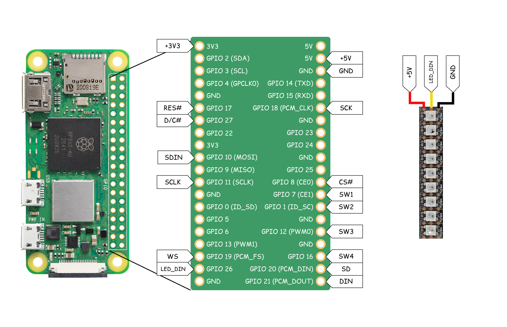

# Tesseract

_An open-source smart speaker for your AI agent_

  
   
   
  <a href="https://www.youtube.com/watch?v=WYpaCrV-wes">▶ Watch the demo (2:15)</a>

 

  
  
  

## Status

- [x] Enclosure CAD and PCB design
- [x] v1 boards fabricated
- [x] Assembly
- [x] Firmware
- [x] Hermes agent integration
- [ ] Dynamic feature generation
- [ ] Smart home integration

## Next Steps

- Personalized software: Tesseract is able to add new features to its code just by you describing them with your voice. For example, a stock ticker widget on the clock screen.

- Smart home integration: Tesseract acts as an endpoint that can connect control to your AI app of choice to let you control your home's devices

## Hardware

### Features

- Crisp 1.91" Square OLED Display
- 9 RGB WS2812b LEDs (on a strip)
- Compact 4 Ohm Speaker
- 4 Programmable Buttons
- Built-in Microphone
- 2.4 GHz Wi-Fi
- Powered via USB-C

Tesseract runs on a Raspberry Pi Zero 2W connected to a custom PCB that links it to a microphone, speaker, display, buttons, and an LED strip. The hardware mainly does cloud API calls, but still runs a wake-word detection model locally.

Tesseract also works as an alarm clock. The main reason I went with an OLED display was so there could be a true black (not like that on an LCD) at night.

The alarm clock is also where the name "Tesseract" came from, since the project is literally a cube with time (a clock face) inside it, kind of like a 4D cube.

## Firmware

### Features

- Hermes Agent compatibility
- Spotify compatibility
- Quiet mode, so finished agent tasks wait for you instead of interrupting
- Night mode to dim screen
- Timers, alarms, weather, and more

Say "Franklin" and ask anything. The firmware in [`code/`](code/README.md) handles on-device wake word
detection, streams speech-to-text, the LLM and text-to-speech through OpenRouter, drives the clock
display (with captions while it talks) and LED strip, and runs timers and alarms.

Simple commands (timers, volume, music controls) are handled on the device. Questions go to a fast model
(currently `gpt-oss-120b`), and anything involving your own stuff (calendar, email, documents) or several
steps goes to your own AI agent (Hermes Agent is currently supported). More details about the code,
setup, pinout and bring-up steps are in [code/README.md](code/README.md).

## Schematic

## PCB

 

## Wiring Diagram

## CAD

You can find the STEP file for the assembled version of Tesseract in the `cad/` directory along with printable
STL files. If you prefer, you can also [view the project in OnShape.](https://cad.onshape.com/documents/c663113203f550a8dc1a02a8/w/2121a6af79302a6b1759fafd/e/e3a5e453c89e8346d1915b92)
Or alternatively, you can find renders of the CAD in the `assets/` subdirectory.

## BOM

_More detailed BOM with links can be found under BOM.csv in main directory_

| Name                               | Quantity | Total Price |
| ---------------------------------- | -------: | ----------: |
| 6mm Buttons                        |        4 |       $1.48 |
| JST XH Cable Connector Kit         |        1 |      $15.79 |
| Raspberry Pi Zero 2W               |        1 |      $19.05 |
| NHD 1.91" OLED Display             |        1 |      $35.70 |
| 0.1uF Capacitors                   |        5 |       $0.95 |
| 10uF Capacitors                    |        5 |       $1.15 |
| 100k Resistors                     |        3 |       $0.90 |
| 210k Resistors                     |        3 |       $0.72 |
| 4Ohm 3W Speaker                    |        1 |      $11.57 |
| PCB                                |        1 |       $3.20 |
| PCB Stencil                        |        1 |       $7.16 |
| MAX98357AETE+T Speaker IC          |        1 |       $3.73 |
| DMM-4026-B-I2S-R Microphone        |        1 |       $2.94 |
| USB-C Breakout Board               |        1 |       $1.62 |
| (Owned) M2.5×8 Screws              |        4 |       $0.00 |
| (Owned) M3×8 Screws                |       12 |       $0.00 |
| (Owned) M3×12 Screws               |        4 |       $0.00 |
| (Owned) M3 Nuts                    |       16 |       $0.00 |
| (Owned) M2.5 Nuts                  |        4 |       $0.00 |
| 2" Plastic 2477 Square             |        1 |       $1.00 |
| (3D Printed) Case                  |        1 |       $0.00 |
| (3D Printed) Display Cover         |        1 |       $0.00 |
| (3D Printed) Speaker Assembly Case |        1 |       $0.00 |
| (3D Printed) Speaker Assembly Lid  |        1 |       $0.00 |
| (3D Printed) LED Chamber           |        1 |       $0.00 |
| (3D Printed) Button Caps           |        4 |       $0.00 |
| M3 Heat-Set Threaded Insert Bag    |        1 |       $3.56 |
| WS2812b LED Strip                  |        1 |       $6.22 |
| Rubber Feet Pack                   |        1 |       $1.93 |
| AliExpress Discounts               |          |      -$8.38 |

### Other Expenses

| Item                      |        Cost |
| ------------------------- | ----------: |
| Tariffs                   |       $8.79 |
| Mouser Tax                |       $5.78 |
| Adafruit Tax              |       $1.60 |
| AliExpress Tax            |       $1.30 |
| JLCPCB Shipping           |      $23.58 |
| T&T Plastic Land Shipping |       $8.00 |
| Mouser Shipping           |       $8.49 |
| Adafruit Shipping         |       $6.37 |
| **Total**                 | **$174.20** |
